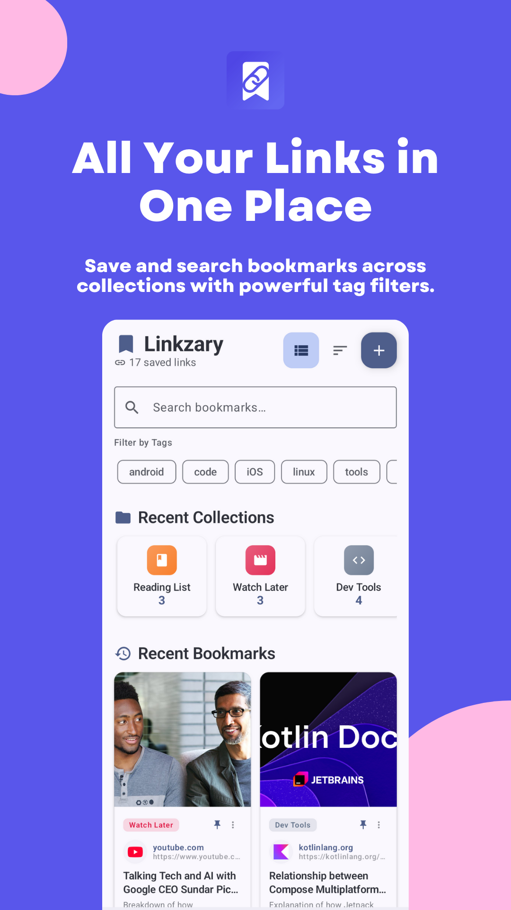
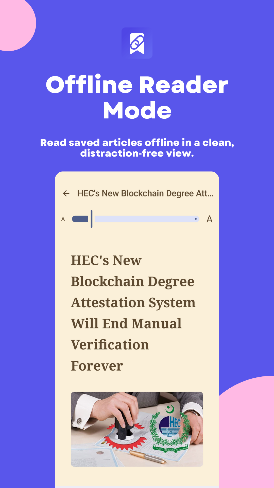
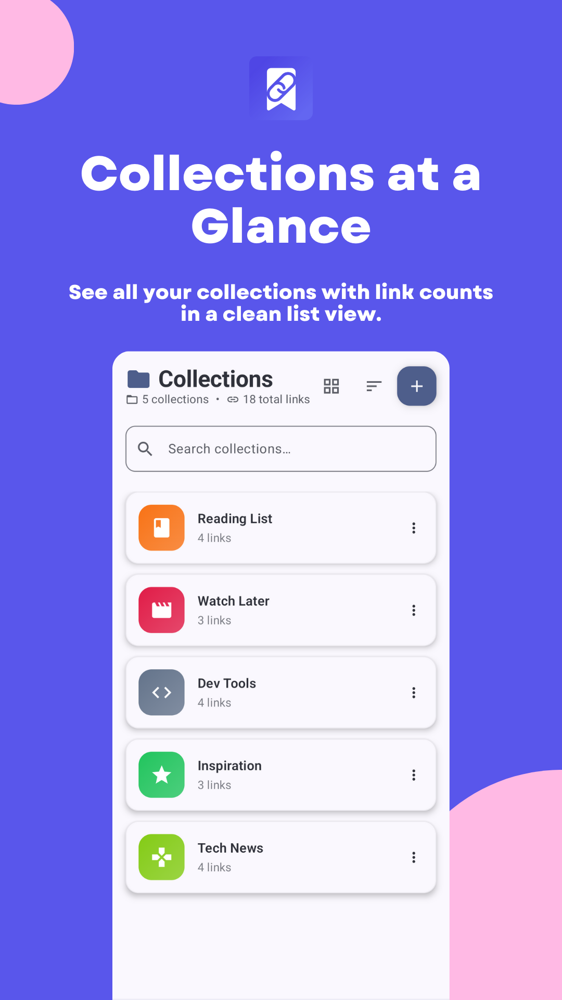
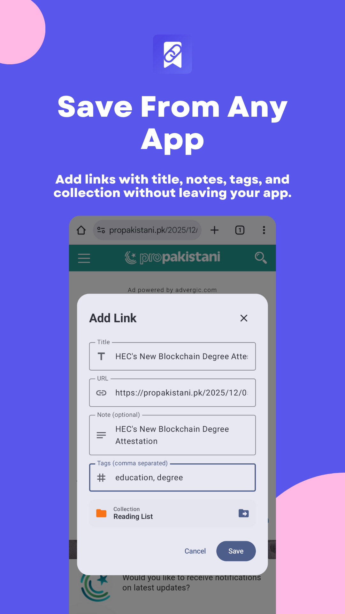

<div align="center">


# Linkzary

**Save it. Organize it. Actually read it.**

A clean, ad-free link & bookmark manager for Android with RSS reading, a distraction-free
article reader, collections, tags, and Google Drive backup — built with Kotlin & Jetpack Compose.

No accounts · No ads · No tracking · Your data stays on your device

[](https://github.com/ZaryabKhan/Linkzary/actions/workflows/build.yml)
[](https://github.com/ZaryabKhan/Linkzary/releases/latest)
[](https://github.com/ZaryabKhan/Linkzary/releases)
[](https://github.com/ZaryabKhan/Linkzary/stargazers)
[](LICENSE)
[](CONTRIBUTING.md)

<a href="https://play.google.com/store/apps/details?id=com.appcodecraft.linkzary&hl=en">
  
</a>

<a href="https://github.com/ZaryabKhan/Linkzary/releases/latest"></a>
<a href="https://buy.polar.sh/polar_cl_J3Nnh3YVrN1jMh8GdYaqZD3FjKvg9lsyR3eih1FkRt8"></a>

</div>

---

## ✨ Why Linkzary?

Most bookmark managers become graveyards — hundreds of links you saved once and never opened again.
Linkzary is built around the whole lifecycle: **saving** links with rich previews, **organizing**
them with collections and tags, **reading** them in a distraction-free reader (even offline), and
**keeping them alive** with health checks and revisit reminders.

| | | |
|:---:|:---:|:---:|
| 🔖 **Save** | 🗂️ **Organize** | 📖 **Read** |
| One-tap saving from the share sheet with automatic title, favicon, and preview extraction | Collections, tags, and duplicate detection with merge | Distraction-free reader that stores content for offline reading |

## 🚀 Features

- 🔖 **Smart link saving** — save any URL with automatic title, favicon, and preview-image extraction; retry with favicon fallback when a site misbehaves.
- 🎴 **Beautiful cards** — every link gets a redesigned card with generated cover art, source line, and a clean footer; collections render as colorful mosaics.
- 📁 **Collections & 🏷️ tags** — group links into themed collections with custom icons, tag links with autocomplete, and act on many links at once with multi-select.
- 🔍 **Duplicate detection** — find duplicate links and merge them in one tap.
- 📰 **RSS feeds** — subscribe to and read your favorite feeds in one place.
- 📖 **Distraction-free reader** — extracts the main article content; saved links keep it for **offline reading**.
- 🩺 **Link health checks** — a background worker periodically checks whether saved links are still reachable.
- ⏰ **Revisit reminders** — schedule reminders to come back to links you meant to read.
- ☁️ **Google Drive backup & restore** — encrypted at rest by Drive, restored in one tap, with errors surfaced in the UI.
- 💾 **Import / Export** — back up and restore via **JSON or CSV**, and import or export **browser bookmarks (HTML)** — perfect for migrating from Chrome or Firefox.
- 🖼️ **Custom thumbnails** — override the auto-generated preview with your own image per link.
- 🎨 **Material 3 theming** — light, dark, and system themes with hue-identity dynamic color, brand colors on by default, theme `SegmentedButtons`, Material 3 haptics, and a scroll-aware extended FAB.
- ✨ **Polished everywhere** — redesigned link cards, a unified dialog style across the app, and a redesigned Settings screen with the donation card up top and a Drive Backup hero card with live status.
- 🧭 **Onboarding** — a friendly first-run flow that gets you productive fast.
- 🌍 **Multi-language** — English, Arabic, German, Spanish, French, Italian, and Portuguese.
- 💝 **Free forever** — optional in-app donations via Google Play Billing; every feature is free, and there are no ads, accounts, or analytics.

## 📸 Screenshots

<div align="center">
  <table>
    <tr>
      <td align="center"><br/><sub>Home — redesigned link cards</sub></td>
      <td align="center"><br/><sub>Reader — distraction-free</sub></td>
      <td align="center"><br/><sub>Collections — mosaic layout</sub></td>
      <td align="center"><br/><sub>Share — quick save</sub></td>
    </tr>
  </table>
</div>

> Captures live in [`docs/images/`](docs/images). Pull requests adding fresh screenshots are very welcome!

## 📲 Get the app

- **Google Play** — [install Linkzary](https://play.google.com/store/apps/details?id=com.appcodecraft.linkzary&hl=en), auto-updated (v1.2.1 is live).
- **GitHub Releases** — grab the latest signed [APK](https://github.com/ZaryabKhan/Linkzary/releases/latest) and sideload it.
- **Build it yourself** — see [Getting started](#-getting-started) below.

Release builds are produced by CI: a signed APK for the GitHub channel and a signed AAB for Play, from a pinned certificate. The app targets SDK 36 and is **16 KB page-size ready**.

## 🛠️ Tech stack

| Layer | Technology |
|---|---|
| 💻 Language | [Kotlin](https://kotlinlang.org/) 2.x |
| 🎨 UI | [Jetpack Compose](https://developer.android.com/jetpack/compose) · [Material 3](https://m3.material.io/) |
| 🏛️ Architecture | **MVVM** + [Hilt](https://dagger.dev/hilt/) dependency injection |
| 🗃️ Database | [Room](https://developer.android.com/training/data-storage/room) |
| ⚙️ Background | [WorkManager](https://developer.android.com/jetpack/androidx/releases/work) for link-health checks & reminders |
| ☁️ Cloud | Google Drive REST (backup & restore) |
| 🌐 Network | [OkHttp](https://square.github.io/okhttp/) · [Jsoup](https://jsoup.org/) · [RSS Parser](https://github.com/prof18/RSS-Parser) |
| 🖼️ Images | [Coil](https://coil-kt.org/) |
| 💳 Payments | [Google Play Billing](https://developer.android.com/google/play/billing) (donations only) |
| 🔧 Serialization | [kotlinx.serialization](https://github.com/Kotlin/kotlinx.serialization) |
| 🧪 Testing | JUnit · AndroidX Test · Espresso · Compose UI Test |

<details>
<summary><strong>📦 Full dependency list</strong></summary>

- `androidx.core:core-ktx`
- `androidx.lifecycle:lifecycle-runtime-ktx`, `lifecycle-viewmodel-compose`, `lifecycle-runtime-compose`
- `androidx.activity:activity-compose`
- AndroidX Compose BOM + `ui`, `ui-graphics`, `ui-tooling-preview`, `material3`, `material-icons-extended`
- `androidx.navigation:navigation-compose`
- `androidx.room:room-runtime`, `room-ktx`
- `com.google.dagger:hilt-android` + `androidx.hilt:hilt-navigation-compose`, `hilt-work`
- `org.jetbrains.kotlinx:kotlinx-coroutines-android`
- `org.jetbrains.kotlinx:kotlinx-serialization-json`
- `com.squareup.okhttp3:okhttp`
- `org.jsoup:jsoup`
- `com.prof18.rssparser:rssparser`
- `androidx.work:work-runtime-ktx`
- `io.coil-kt:coil-compose`
- `com.android.billingclient:billing-ktx`
- `com.google.android.gms:play-services-auth` (Drive account sign-in)
- `com.android.tools:desugar_jdk_libs` (core library desugaring)

</details>

## 📋 Requirements

- **Android Studio** with AGP 9.x / Gradle 9.3 support
- **JDK 17** or newer
- **Android SDK 36** (`compileSdk = 36`, `minSdk = 26` (Android 8.0), `targetSdk = 36`)

## 🚀 Getting started

```bash
# 1. Clone the repository
git clone https://github.com/ZaryabKhan/Linkzary.git
cd Linkzary

# 2. Build a debug APK
./gradlew assembleDebug

# 3. Run unit tests
./gradlew test

# 4. Open in Android Studio and run on a device/emulator
```

The debug APK lands at `app/build/outputs/apk/debug/app-debug.apk`.

<details>
<summary><strong>🔧 JDK note for CLI builds</strong></summary>

The project does **not** ship a machine-specific `org.gradle.java.home` in version control, so command-line builds use the JDK on your `JAVA_HOME`/`PATH`. To pin a specific JDK for local CLI builds, set:

```properties
org.gradle.java.home=...
```

…in `~/.gradle/gradle.properties` (user-level, **not** committed).
</details>

## 🧭 Project structure

```text
app/src/main/java/com/appcodecraft/linkzary/
├── billing/         # Google Play Billing (donations)
├── data/
│   ├── converter/   # Room type converters
│   ├── dao/         # Data access objects
│   ├── database/    # Room database definition + migrations
│   ├── entity/      # Room entities (SavedLink, Collection, RssFeed)
│   ├── model/       # Import/export data models
│   ├── preferences/ # User preferences manager
│   ├── repository/  # Repositories (Link, Collection, Rss)
│   └── service/     # Import/export (JSON & CSV), bookmarks HTML, Drive backup
├── di/              # Hilt modules (Database, Network, Preferences)
├── navigation/      # Compose navigation graph
├── ui/
│   ├── activity/    # MainActivity, ShareActivity
│   ├── component/   # Reusable Compose components (incl. Drive backup card)
│   ├── screen/      # Feature screens (home, reader, rss, collections, tags, stats, settings, onboarding, donation, share)
│   └── theme/       # Material 3 colors, typography, themes
├── util/            # Article & URL metadata extraction, Drive error messages, UrlOpener
├── utils/           # LocaleHelper
└── worker/          # WorkManager link-health checks
```

## 🤝 Contributing

Contributions are welcome! Read [CONTRIBUTING.md](CONTRIBUTING.md) to set up the project and submit pull requests.

Looking for a good place to start? Check issues labeled [`good first issue`](https://github.com/ZaryabKhan/Linkzary/labels/good%20first%20issue) and [`help wanted`](https://github.com/ZaryabKhan/Linkzary/labels/help%20wanted).

```bash
git checkout -b feat/my-awesome-feature   # Fork → Branch → Commit → PR
```

<details>
<summary><strong>📜 Code of conduct</strong></summary>

By participating you agree to abide by the [Code of Conduct](CODE_OF_CONDUCT.md). Be kind and respectful.
</details>

## 🔒 Security

Found a vulnerability? Please **do not** open a public issue — see [SECURITY.md](SECURITY.md) for how to report it privately.

## 📝 Changelog

See the [Releases](https://github.com/ZaryabKhan/Linkzary/releases) page for version history. Recent highlights:

- **v1.2.1** — Drive sign-in rewritten to the modern `AuthorizationClient` flow (fixes the device-side "key error"), actionable typed Drive error messages with a re-auth prompt, and signed release builds on CI. Live on both [GitHub](https://github.com/ZaryabKhan/Linkzary/releases/latest) and Google Play.
- **v1.2.0** — Google Drive backup/restore, browser-bookmarks HTML import/export, duplicate detection with merge, revisit reminders, tag autocomplete, custom thumbnails, and a full card redesign with generated covers and mosaic collections. Details: [docs/CHANGELOG-v1.2.0.md](docs/CHANGELOG-v1.2.0.md).

## 📜 License

Linkzary is licensed under the **MIT License** — see [LICENSE](LICENSE).

---

<div align="center">

Built with ❤️ by [Zaryab Khan](https://github.com/ZaryabKhan) & [contributors](https://github.com/ZaryabKhan/Linkzary/graphs/contributors).

If Linkzary is useful to you, consider ⭐ starring the repo or [donating](https://buy.polar.sh/polar_cl_J3Nnh3YVrN1jMh8GdYaqZD3FjKvg9lsyR3eih1FkRt8) to support development.

[Report a bug](https://github.com/ZaryabKhan/Linkzary/issues/new?labels=bug&template=bug_report.md) · [Request a feature](https://github.com/ZaryabKhan/Linkzary/issues/new?labels=enhancement&template=feature_request.md) · [Discussions](https://github.com/ZaryabKhan/Linkzary/discussions)

</div>
